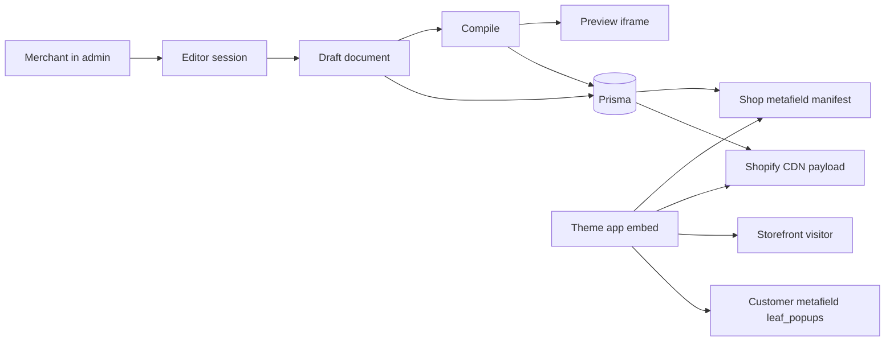

# Popup builder architecture

This is a design to review before any implementation. Popup types are presets over one document model, not four separate products.

## Stack and boundaries

- Shopify React Router app template, React, Node.js, Prisma, and the Shopify GraphQL Admin API at the version the template pins.
- App package: `@shopify/shopify-app-react-router`. Embedded admin UI: `@shopify/app-bridge-react` (`AppProvider`, `NavMenu`, `TitleBar`).
- Every admin loader and action calls `authenticate.admin` from `app/shopify.server.js` and uses the GraphQL client on that result for Shopify writes (`metafieldsSet`, `fileCreate`, discount mutations, customer updates).
- Admin chrome is Polaris web components only (`s-page`, `s-section`, `s-button`, and the rest of the template's Polaris set). No Tailwind, no `@shopify/polaris` React package, no custom admin stylesheet.
- The popup preview is the one surface that is not Polaris. It runs inside a sandboxed iframe and paints with the same renderer and tokens as the storefront. Polaris cannot be that renderer, or the preview would stop matching the theme.
- Storefront integration is a Theme App Extension. No script tags.

## System shape

Three copies of a popup design exist, on purpose:

- **Draft document** — what the merchant is editing. Rich, normalized, includes editor-only fields. Stored in Prisma.
- **Compiled document** — what the renderer understands. Nested, closed vocabulary, no editor metadata. The preview and the storefront both consume this shape, produced by the same compile step.
- **Manifest entry** — a few rules used to decide whether a page should load a compiled document at all. Stored on the shop.

Customer engagement is a fourth record, and it does not live in Prisma. See the data split below.

## Where each kind of data lives

Customer metafields win whenever the data is about a person. Prisma wins whenever the data is the merchant's design or the app session. A popup design is shop configuration: anonymous visitors have no customer record, and writing a campaign onto one customer would not publish it to the storefront.

**Customer metafields, namespace `leaf_popups`, owner `CUSTOMER`.** One JSON metafield, key `state`, created with `metafieldDefinitionCreate` on install:

- Popups shown, dismissed, and submitted, keyed by popup id, with timestamps.
- Email consent and the popup that collected it.
- A per-customer discount code when the campaign issues unique codes.

A logged-in visitor exposes this to the embed through Liquid (`customer.metafields.leaf_popups.state`). The embed treats that as the frequency record. Guests have no customer, so the embed keeps a browser-local copy until an email submit identifies them. Submit goes through the app proxy, signature-checked. The app then uses the shop's offline Admin GraphQL client to find or create the customer and `metafieldsSet` the `leaf_popups` state. The merchant's leads list is a GraphQL customer query filtered to that metafield, not a local table. Reading customer email for that list needs protected customer data access before App Store review.

**Prisma, and only for non-customer data:**

- The session table the template already requires.
- Popup rows: name, preset, status, schema version, draft document, draft behavior, compiled payload, content revision, timestamps.
- A publication row: the manifest last written to Shopify, and whether that write succeeded.

**Shop metafield, same namespace `leaf_popups`, owner `SHOP`, key `manifest`.** The published campaign index the embed reads on every page. This is not customer data and it is not the draft. JSON metafields for new apps are capped at 128KB, so the manifest stays a list of rules plus CDN URLs. Full designs are not inlined.

Shared public discount codes stay inside the compiled document, because every visitor sees the same code. Unique codes stay on the customer metafield.

## 1. Builder state

Keep three in-memory stores apart. Mixing them is what makes nested builders unmaintainable.

**Document store** — serializable, autosaved to Prisma. Normalized, not a deep tree:

- A node map keyed by id.
- Each node has `type`, `parentId`, ordered `childIds`, `props`, and `style`.
- A single `rootId`.

Normalization makes a nested move a change to two child lists. A nested JSON tree would be copied on every keystroke and would make undo and drag bookkeeping fragile.

**Behavior store** — serializable, autosaved to Prisma, sibling of the tree. Triggers, frequency, schedule, page and device targeting, and the goal (email, discount, announcement). Changing "show on exit" must not rebuild the canvas.

**Editor session** — memory only. Selection, hover, drag gesture, device width, edit-versus-interact mode, clipboard, and the undo cursor. Never written to Prisma or to a metafield.

Mutations go through a small command set: insert, move, reparent, update props, update style, delete, duplicate. Each command checks a **containment registry** before it runs. The registry is the product rules: a bar root cannot contain a modal; a form can contain fields and a button; a column can contain content blocks; a coupon block is allowed only when the goal is a discount. Invalid drops are refused at the command, so the preview cannot drift into a tree the storefront would reject.

Undo and redo store reversible patches of the document and behavior stores only. Dragging does not push history on every pointer move; one command is committed when the gesture ends.

The route loader, after `authenticate.admin`, hydrates the stores when the editor opens. After that, the in-memory stores are authoritative for the session. Autosave debounces the draft back through an action on the same authenticated route. Publish is a separate action. A stale `updatedAt` check is enough for conflicts; this is a single-merchant editor, not a collaborative one.

The page, toolbar, property panel, and device toggle are Polaris web components. They read the selected node and behavior store. They do not render the popup.

**Layout model.** The tree is nested flow: stacks, columns, gaps, alignment, and padding. It is not a freeform page of absolute x/y coordinates. The four popup types are all flow layouts, and absolute positioning breaks the "same renderer on every viewport" goal. A later freeform mode can exist as one node type with its own children; it should not be the document model.

**Popup types are presets.**

- Email capture: modal root, form, goal `email`. Submit writes `leaf_popups.state` on the customer.
- Discount reveal: modal root, coupon block, goal `discount`. A shared code is created with the Admin GraphQL discount APIs at publish time and stored on the behavior record. A unique code is written onto that customer's metafield when they qualify.
- Exit intent: any modal tree whose trigger is exit. The visual tree is not a separate type.
- Announcement bar: bar root, no overlay, trigger usually immediate, can show beside a modal.

The merchant can change trigger and goal after creation. `kind` on the record is the preset they started from, not a permanent schema branch.

## 2. One renderer, isolated preview

The storefront cannot run the admin React tree, and Polaris must not paint the popup. Share a **renderer with no admin dependencies**. It accepts a compiled document and mounts it inside a **closed shadow root**, with the popup's own tokens and CSS. Theme CSS cannot restyle it, and the admin page cannot restyle the preview. That isolation is the accuracy guarantee: both surfaces paint the same nodes with the same styles.

Admin preview is a sandboxed iframe on the Polaris page, not a Polaris layout of the popup. The iframe loads that same renderer. The parent never sends the draft document. On each edit it compiles, then posts the compiled document. Compile is pure and runs on animation frames, so the preview matches publish output while the merchant is still typing.

Drag-and-drop happens **inside the iframe**, where hit targets match what is drawn. During the gesture the iframe owns the pointer. On drop it posts a command (`move this id to this parent at this index`). The parent applies the command, compiles, and posts the next document. The Polaris property panel stays outside the iframe. Selection id is the only other thing synced. Edit mode selects and drags; interact mode runs triggers and a simulated form so the merchant can preview behavior without creating a customer or writing a metafield.

What this preview does not show is the merchant's theme around the popup. Shadow DOM is what makes the popup itself stable. Seeing it on the real theme is a second mode: open the storefront with a short-lived signed draft token. The embed fetches that draft from the app and renders it with the same renderer. The canvas iframe remains the working surface.

## 3. Schema

**Compiled document** (the contract the renderer and the CDN file share):

- `schemaVersion`
- `kind`: `modal` or `bar`
- `tokens`: color, type, radius, overlay, width
- `root`: a nested node
- Each node: `id`, `type`, `props`, `style`, optional `children`

Node types are a closed set: stack, columns, text, image, button, spacer, divider, form, field, coupon, countdown, close. No raw HTML. Unknown types and unknown future fields are ignored by older renderers; breaking changes bump `schemaVersion` and run a pure migration when a draft is opened. Published payloads stay frozen at the version they were compiled with. The renderer supports the current version and one back.

**Behavior**, stored beside the tree in Prisma, not inside it:

- Trigger: immediate, delay, scroll depth, or exit
- Frequency: every visit, once, or after N days
- Schedule window
- Targeting: device, included and excluded paths or template types
- Goal: none, email, or discount, plus the Shopify discount id and the public code when the code is shared

**Customer state** (`leaf_popups.state`), the only per-person schema:

- `popups`: map of popup id to `{ lastShown, dismissedAt, submittedAt }`
- `consent`: `{ at, popupId }` when they opted into email
- `codes`: map of popup id to the unique code issued to that customer

**Editor document** is the normalized form of the same nodes plus editor-only fields (`parentId`, `childIds`, lock, display name). Compile strips those, nests children, resolves image URLs, and writes tokens through. If compile cannot produce a valid tree, publish is blocked.

## 4. Storefront delivery

The extension is one **app embed block** targeted at the page body, enabled once by the merchant in the theme editor. The app deep-links them there. It cannot turn the embed on itself. The embed does not run on checkout. One embed renders every popup; individual popups are data.

A section app block is the wrong placement for these four types. Section blocks render only where a merchant drops them on a template, so an exit-intent or email popup would miss every page they forgot. Announcement bars use the same embed so they also run site-wide. Script tags are not used.

Publish does four things, all from an authenticated admin action via Admin GraphQL:

1. Compile the draft into the storefront document.
2. Save that payload on the Prisma popup row.
3. `fileCreate` the payload so it is served from the Shopify CDN. The URL is content-addressed by revision, so a republish is a new URL.
4. `metafieldsSet` the shop manifest at `leaf_popups.manifest`: for each active popup, id, revision, kind, priority, trigger, frequency, schedule, targeting, and the CDN URL.

The embed's Liquid prints that manifest into the page, and when a customer is logged in it also prints `leaf_popups.state`. The renderer script is an extension asset on the Shopify CDN.

On each page the embed script:

1. Reads the manifest from the page. No app request.
2. Drops campaigns that fail device, schedule, path, or frequency checks. Logged-in frequency comes from the customer metafield. Guest frequency stays in the browser until submit.
3. If nothing remains, it stops. No design file is downloaded.
4. Otherwise it fetches **one** compiled document from the CDN URL and mounts it in the shadow root when the trigger fires. Exit intent and long delays fetch when the visitor qualifies, not at first paint.
5. At most one modal shows. A bar may show with it. Priority on the manifest breaks ties.

Email submit and unique-code issuance go to the app through the app proxy. The handler verifies the proxy signature, then writes the customer and `leaf_popups.state` with Admin GraphQL. It does not use `authenticate.admin`, because that helper is for the embedded admin session. Reads of published designs do not hit the app. Draft preview is the exception: a signed, expiring URL served by the app, never written to the public CDN and never written onto a customer.

Pause and unpublish rebuild the shop manifest. The old CDN file can remain until it ages out; the manifest no longer points at it. Customer metafields are left in place so frequency and consent survive a pause.

## Decisions worth challenging

- Nested flow instead of a freeform canvas.
- Compiled document as the only input to the renderer, including the admin preview.
- Prisma for drafts and sessions; shop metafield for the manifest; customer metafield `leaf_popups.state` for everything about a person.
- An app embed block for site-wide popups and bars, rather than a section app block the merchant must place on each template.
- Closed node types, so the storefront never renders merchant-authored HTML.
