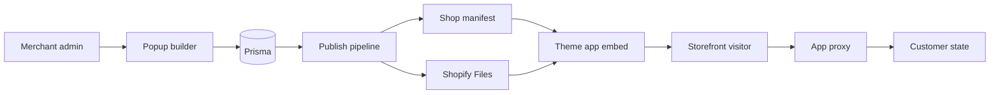

# Leaf Popups architecture

Leaf Popups uses one normalized editor model and one storefront rendering
contract for every popup preset. Email capture, discounts, exit intent, and
announcement bars are configurations of that shared model rather than separate
products.

## System boundaries

- The embedded admin uses React Router and Polaris web components.
- The popup preview is isolated in a sandboxed iframe and uses the same
  dependency-free renderer as the storefront.
- The storefront integration is one theme app embed. It is not a script tag or
  a section block.
- Admin requests authenticate with `authenticate.admin`; storefront writes use
  the signed app proxy and an offline Admin API client.

## Data ownership

### Prisma

Prisma stores non-customer application data:

- Shopify sessions;
- merchant-authored popup drafts and behavior;
- compiled publication payloads and revisions;
- the last publication manifest and synchronization status.

Draft documents are normalized node maps. Builder commands are responsible for
insert, move, reparent, property/style updates, deletion, and duplication.
Containment checks reject invalid trees before they reach the compiler.

### Shopify shop data

The shop metafield `leaf_popups.manifest` is the published campaign index. It
contains targeting and trigger metadata plus content-addressed Shopify Files
URLs. Full popup designs are kept out of the manifest.

### Shopify customer data

The customer metafield `leaf_popups.state` stores per-person engagement:

- shown, dismissed, and submitted timestamps by popup;
- consent metadata;
- unique discount codes.

Anonymous visitors use browser-local state until a submission identifies them.
The leads view queries Shopify customers rather than maintaining a second
customer database.

## Editor and compiled contracts

The editor keeps three concerns separate:

1. the serializable normalized document;
2. serializable behavior such as triggers, targeting, schedule, and frequency;
3. transient session state such as selection, drag state, device preview, and
   undo position.

Publishing converts the normalized document into a closed, nested storefront
contract. It includes a schema version, presentation kind, design tokens, and a
root node. Unknown node types are never generated and merchant-authored raw
HTML is not supported.

The compiled document is the only input to both render surfaces:

- the admin iframe receives it with `postMessage`;
- the storefront embed fetches it from Shopify Files.

The renderer in `extensions/leaf-popups-embed/assets/renderer.js` is a
hand-maintained browser IIFE. Changes to node types, compiled fields, or schema
versions must be coordinated with `app/popup/types.ts`,
`app/popup/compile.ts`, and the renderer.

## Publishing flow

Publishing an active popup:

1. validates and compiles the current draft;
2. saves the compiled payload and revision in Prisma;
3. uploads the payload to Shopify Files;
4. rebuilds `leaf_popups.manifest` with active campaigns.

Pausing or unpublishing rebuilds the manifest without the campaign. Old
content-addressed files can remain because storefronts no longer reference
them.

On each page, the embed reads the Liquid-rendered manifest, filters campaigns
by device, schedule, path, and frequency, then fetches only the selected
payload. At most one modal is shown; an announcement bar can appear alongside
it.

## Storefront writes and previews

Email submissions and engagement events are posted to `/apps/leaf-popups`,
which Shopify proxies to `/proxy`. The route validates the proxy signature
before using the shop's offline Admin API context.

Published designs are read from Shopify's CDN and do not require an application
request. Draft-on-store previews are the exception: they use a signed,
short-lived token and never publish the draft.

## Operational constraints

- The current SQLite datasource is for local or durable single-instance use.
  Ephemeral hosts require persistent storage or a managed database migration.
- The app embed must be deployed and enabled in the merchant's theme.
- The leads workflow requires protected customer data approval before App Store
  distribution.
- Mandatory privacy compliance webhooks must be implemented before App Store
  submission.
